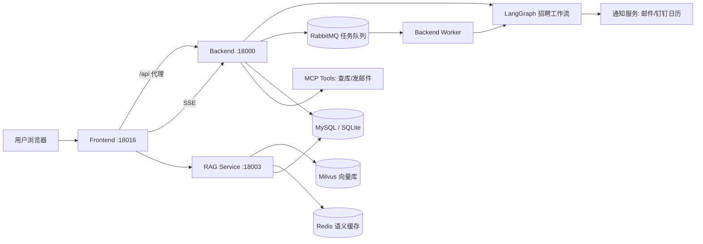

# 智聘云（Boss_bot）— AI 智能招聘助手

一个覆盖「简历解析 → 智能分析 → 自动分流 → 问卷/面试 → 录用决策」全流程的 AI 招聘系统。
后端用 **FastAPI + LangGraph** 把招聘流程编排成状态机，LLM（OpenAI 兼容接口，如 DeepSeek）负责
简历分析、面试评审、自然语言问答；另有一个独立的 **RAG 服务** 做企业制度知识库问答；
前端为 **React + TypeScript + Vite + Tailwind** 的单页应用。

> 本文档基于对代码的实际审核编写，描述的是当前代码的真实结构与行为。

---

## 1. 核心能力

| 能力 | 说明 |
|------|------|
| 简历解析 | 支持 PDF / Word / TXT / 图片；扫描件 PDF 自动走 OCR（PaddleOCR） |
| AI 智能分析 | 基本信息 / 技能 / 经验 **3 路并行分析** + 综合加权打分（技能 40% + 经验 40% + 稳定性 20%） |
| 自动分流 | 按匹配分阈值（默认 80 / 60 / 40）自动路由：直接面试 / 问卷 / 人才池 / 结束 |
| 面试排期 | 基于约束自动生成 3 个可选时间段，候选人确认后落库，可选钉钉日历集成 |
| 面试评审 | 面试后 **3 路并行评审**（技术 / 沟通 / 文化）+ Supervisor 综合决策 |
| 制度问答 RAG | 文档上传 → 向量化（BGE-M3）→ Milvus 混合检索 → CrossEncoder 重排 → LLM 回答（SSE 流式） |
| 自然语言查询 | Function Calling + MCP 工具：用中文直接查候选人 / 面试 / 数据，甚至发邮件 |
| 通知 | 邮件模板（问卷 / 面试 / 提醒 / 拒信 / Offer），多渠道预留 |
| 可观测性 | 每次 LLM 调用自动记录：输入输出、Token 估算、延迟，可查询聚合统计 |
| 高并发防护 | 简历分析任务可入 RabbitMQ 队列（有界并发 + 死信 + 重试），不可用时自动降级为内联同步 |

---

## 2. 技术栈

- **后端**：Python 3.11 / FastAPI / Uvicorn / SQLAlchemy 2.0（async）/ Pydantic v2
- **工作流**：LangGraph（StateGraph + 条件边 + Send 并行分支）
- **LLM**：OpenAI 兼容接口（`openai` SDK），DeepSeek 等可替换
- **AI 协议**：MCP SDK（5 个工具：候选人查询 / 详情 / 面试 / 仪表盘统计 / 发邮件）
- **队列**：aio-pika（RabbitMQ），durable 队列 + 死信 + TTL 重试
- **RAG**：pymilvus / Milvus 2.4 / BGE-M3 混合检索 / sentence-transformers 重排 / Redis 语义缓存
- **数据**：MySQL（生产，`aiomysql`）；SQLite（开发/Docker，`aiosqlite`）
- **前端**：React 18 / TypeScript / Vite / Tailwind CSS / recharts
- **认证**：JWT（python-jose）+ bcrypt；RBAC 角色：admin / hr / interviewer / candidate
- **其他**：PyMuPDF（PDF）、python-docx、PaddleOCR（扫描件 OCR）、Dify（考试分析，可选）、httpx

---

## 3. 系统架构

### 3.1 运行时服务

| 服务 | 端口 | 入口 | 说明 |
|------|------|------|------|
| Backend（主后端） | 18000 | `backend/src/app/main.py` | API + LangGraph 招聘工作流 + MQ 发布/消费 + 定时任务 |
| RAG Service | 18003 | `rag_service/src/app/main.py` | 企业制度文档索引 + 混合检索问答（SSE） |
| Frontend | 18016 | `frontend/`（Vite dev） | React SPA，`/api` 由 Vite 代理到 18000 |
| Backend Worker（可选） | - | `python -m app.queue.worker` | 独立消费简历分析任务队列 |
| 基础设施（可选） | - | docker-compose | MySQL / Milvus+MinIO / Redis / RabbitMQ |

### 3.2 服务拓扑



### 3.3 一次简历的完整数据流

```
HR 创建候选人 / 上传简历
  → /api/resumes/upload       解析文件为纯文本（PDF/DOCX/TXT/OCR）
  → /api/resumes/{id}/analyze 或 /api/workflow/start/{id}
  → LangGraph:
      parse_resume → classify(16 类关键词+LLM兜底)
      → 3 路并行分析(basic/skills/experience) → synthesize(加权算分)
      → 按 match_score 分流
          ≥80 → 面试排期    60~79 → 问卷(固定链接) → 通过→面试
          40~59 → 人才池     <40 → 结束
  → schedule_interview → confirm → complete
  → 3 路并行评审(技术/沟通/文化) → supervisor_decision(录用/拒绝 + 邮件通知)
  → 状态与结果写回 candidates / resumes / interviews 等表
```

---

## 4. 目录结构

```
Boss_bot/
├── .env.example                 # 环境变量模板（唯一配置源，复制为 .env）
├── docker-compose.yml           # 一键部署：backend + rag + milvus + minio + rabbitmq + worker
├── Dockerfile.backend           # Backend 镜像（uvicorn app.main:app --app-dir src，监听 8000）
├── Dockerfile.rag               # RAG 镜像（uvicorn app.main:app --app-dir src，监听 18003）
├── start_all.py                 # 本地开发一键启动（backend + frontend + rag）
├── seed_admin.py                # 初始化管理员脚本（自动定位 backend/src）
├── requirements-dev.txt         # 开发/测试依赖（pytest 等）
├── pyrightconfig.json           # 类型检查配置（extraPaths 指向 backend/src、rag_service/src）
│
├── backend/                     # 主后端（Maven 式模块：src + pyproject.toml）
│   ├── pyproject.toml           # ≈ pom.xml：依赖声明、构建配置、pytest（pythonpath=src）
│   ├── requirements.txt         # 独立依赖清单（pip install -r 用，与 pyproject 保持一致）
│   ├── alembic.ini / migrations/# Alembic 迁移（env.py 已指向 src）
│   ├── src/app/                 # ≈ src/main：应用包（入口 app.main:app）
│   │   ├── main.py              # FastAPI 入口：lifespan、CORS、全局异常处理、路由注册
│   │   ├── config.py            # Pydantic Settings（自动向上查找根 .env）
│   │   ├── database.py          # SQLAlchemy 异步引擎 / get_db / init_db(create_all)
│   │   ├── dependencies/        # auth：bcrypt 哈希、JWT、get_current_user、require_role
│   │   ├── models/              # 11 张 ORM 表（candidate/resume/interview/...）
│   │   ├── schemas/             # Pydantic 请求/响应模型
│   │   ├── routers/             # 10 个 API 模块（见 §9）
│   │   ├── agents/              # LLM 层：llm_client / prompts / tracing
│   │   ├── workflow/            # LangGraph 编排：state / graph / nodes/（9 类节点）
│   │   ├── mcp/                 # MCP Server(stdio) + 内联 Client + tools(database/email)
│   │   ├── queue/               # RabbitMQ broker + worker（可降级）
│   │   ├── services/            # 简历分析/排期/通知/日历/问卷/考试分析/定时任务/Milvus索引
│   │   └── utils/               # SSE 事件工具
│   └── tests/                   # ≈ src/test：镜像 src 结构（routers / workflow / llm_client）
│
├── rag_service/                 # 独立 RAG 服务（Maven 式模块）
│   ├── pyproject.toml           # ≈ pom.xml：依赖声明、构建配置、pytest（pythonpath=src）
│   ├── requirements.txt         # 独立依赖清单
│   ├── start.py                 # 本地启动脚本（uvicorn app.main:app --app-dir src）
│   ├── src/app/                 # ≈ src/main：应用包（入口 app.main:app）
│   │   ├── main.py / config.py / database.py
│   │   ├── agents/              # llm_client / prompts
│   │   ├── routers/             # chat(SSE) / documents
│   │   ├── services/            # policy_rag(检索管线) / policy_text_splitter / semantic_cache
│   │   └── models/              # policy 表
│   └── tests/                   # ≈ src/test：policy_rag 管线测试
│
└── frontend/                    # React SPA
    └── src/
        ├── App.tsx              # 路由表
        ├── contexts/AuthContext.tsx  # 登录态/JWT 存取
        ├── lib/api.ts           # 所有后端接口封装（含 SSE 解析）
        ├── components/          # Layout / ProtectedRoute / Toast
        └── pages/               # Login/Dashboard/Candidates/CandidateDetail/...
```

> **目录规范（Maven 式）**：每个服务模块都有独立的 `pyproject.toml`（≈ pom.xml）声明依赖与构建配置；源码统一放在 `src/`（≈ src/main），测试统一放在 `tests/`（≈ src/test）并镜像源码结构；根目录只保留跨服务共享的编排/部署文件（docker-compose、Dockerfile、start_all.py、.env）。


---

## 5. 核心业务：LangGraph 招聘工作流

### 5.1 状态对象 `workflow/state.py`

`RecruitmentState`（TypedDict）贯穿整个流程，所有节点读写同一个 State，LangGraph 自动合并返回值。
关键字段：候选人信息、`status`、`pipeline_stage`、`resume_text`、`job_category`、三路分析结果、
`match_score`、问卷/面试状态、三路评审结果、Function Calling 字段、`errors`/`retry_count`。

### 5.2 图定义 `workflow/graph.py`

- 入口：`parse_resume`
- 条件路由（`should_send_questionnaire`，阈值来自 `.env`）：
  - `match_score >= 80` → `schedule_interview`（快速通道）
  - `>= 60` → `generate_questionnaire`（问卷通道）
  - `>= 40` → `move_to_talent_pool`（人才池）
  - `< 40` → 结束
- 面试完成 → `route_to_reviewers` 并行拆 3 路 → `supervisor_decision` → 结束

### 5.3 并行分支（LangGraph `Send`）

| 阶段 | 并行节点 | 汇合节点 |
|------|----------|----------|
| 简历分析 | `analyze_basic_info` / `analyze_skills` / `analyze_experience` | `synthesize_analysis`（加权算分） |
| 面试评审 | `technical_review` / `communication_review` / `culture_review` | `supervisor_decision`（录用/拒绝） |

### 5.4 降级机制

`workflow/agent_client.py` 会优先调用独立的 Agent HTTP 服务（旧架构端口 18001~18008）；
调用失败时节点内部自动回退到「内联 LLM 调用」（`agents/llm_client.py`），保证核心功能可用。

---

## 6. 模块详解

### 6.1 认证与权限（`routers/auth.py` + `dependencies/auth.py`）

- `POST /api/auth/setup`：仅当系统**没有任何管理员**时可用，用于创建首个管理员。
- `POST /api/auth/register`：**仅管理员可调用**，只能创建 HR / interviewer 角色（避免公开注册被滥用）。
- `POST /api/auth/login`：返回 JWT（`sub`=用户名，`role`=角色），过期时间默认 24h。
- `GET /api/auth/me`、`POST /api/auth/change-password`。
- 密码使用 **bcrypt 直接哈希**（不依赖 passlib）。
- 权限控制：`require_role([...])` 依赖用于路由级 RBAC。

### 6.2 LLM 客户端与可观测性（`agents/`）

- `llm_client.py`：唯一 LLM 入口，三种模式：
  - `chat()` — 同步等完整回复（结构化 JSON 分析等）
  - `stream_chat()` — 逐 token 流式（SSE 打字机）
  - `stream_chat_json()` — 流式但攒完整 JSON 后一次性返回
- `tracing.py`：`@trace_llm_call` 装饰器自动把每次调用的输入/输出/延迟/Token 估算写入 `llm_logs` 表。
- `prompts.py`：4 套提示词（简历分析 / 面试排期 / 制度问答 / 反馈摘要）及多 Agent 专用提示词。

### 6.3 MCP 工具与 Function Calling（`mcp/` + `workflow/nodes/function_calling.py`）

- 5 个工具：`query_candidates` / `get_candidate_detail` / `query_interviews` / `get_dashboard_stats` / `send_email`。
- `mcp/server.py`：标准 stdio MCP Server，可被任意 MCP Client 连接。
- `mcp/client.py`：提供「内联直连」执行（跳过协议开销），供 LangGraph Function Calling 节点使用。
- 流程：用户自然语言 → LLM 选工具 → 逐个执行 → 结果回填 → 流式回复（`/api/workflow/function-call/stream`）。

### 6.4 异步任务队列（`queue/`，高并发防护）

- `publish_analysis_task()`：把「分析某候选人」发布到 durable 队列，返回 `task_id`。
- worker（`python -m app.queue.worker`）有界并发消费（`prefetch_count` 默认 8）。
- 可靠性：主队列带死信（DLX）+ retry 队列带 TTL（指数退避重试，默认 5 次）。
- **自动降级**：未安装 aio-pika 或 RabbitMQ 不可达时抛 `BrokerUnavailable`，接口回退为内联同步执行。
- 进度：写入 `task_progress` 表，前端轮询 `GET /api/workflow/task/{task_id}`。

### 6.5 通知与日历（`services/`）

- `notification.py`：模板化邮件（问卷邀请/催填、面试邀请/确认/提醒、拒信、Offer），支持自定义内容。
- `calendar_svc.py`：钉钉日历事件创建（可选，需 `DINGTALK_APP_KEY/SECRET`）。
- `notification` 记录统一写入 `notifications` 表。

### 6.6 定时任务（`services/scheduler_tasks.py`）

`main.py` lifespan 启动，每 300s 一轮：
- 面试提醒：已确认且距开始约 24h 的面试，自动发送提醒邮件（`reminder_sent` 去重）。
- 人才池归档：入池超过 90 天的记录自动 `archived`。

### 6.7 简历解析（`services/resume_analyzer.py`）

- txt / docx / pdf 直接解析；PDF 提取文本过少（<50 字符）判定为扫描件，逐页渲染 300dpi 图片走 PaddleOCR。
- 图片（jpg/png/bmp/tiff 等）直接 OCR。
- `analyze_resume()`：LLM 结构化提取 + 匹配度评分（overall_score + dimensions + strengths/risks）。

### 6.8 考试分析（`routers/exam_analysis.py` + `services/exam_analysis_svc.py`）

- `POST /api/exam-analysis/webhook`：轻速云回调入口，需 `X-Webhook-Token` 头（`EXAM_WEBHOOK_TOKEN`）。
- 收到后异步调用 Dify Workflow 分析；未配置 `DIFY_API_KEY` 时使用内置模拟分析。

### 6.9 RAG 服务（`rag_service/`，制度问答）

- 索引：文档 → **双层分块**（父 1200 / 子 300，重叠 50）→ BGE-M3 稠密+稀疏向量 → Milvus（集合 `policy_docs_v2`）。
- 查询：关键词/LLM 判定是否制度问题 → 混合检索（稠密 1.0 / 稀疏 0.7）→ 子块命中→父块去重 →
  CrossEncoder 重排（Top5）→ LLM 生成答案并附引用来源。
- 语义缓存：Redis，embedding 相似度 ≥ 0.92 直接命中缓存（TTL 24h）。
- `POST /api/chat/stream`：SSE 流式（progress / sources / token / done）。
- 对话历史写入 `policy_chat_history`（按 `session_id`）。

### 6.10 前端（`frontend/`）

- 路由：`/login` 公开；其余经 `ProtectedRoute` 鉴权后进入 `Layout`（侧边栏 + 顶栏）。
- 登录态：JWT 存 `localStorage`（key：`boos_bot_auth`），`api.ts` 统一注入 `Authorization`，401 自动登出。
- SSE 解析：`lib/api.ts` 内置 ReadableStream 解析器，逐事件分发（token/progress/done/sources）。
- 页面：Dashboard / Candidates / CandidateDetail / Questionnaires / Interviews / PolicyAgent(AI 问答) / Pipeline(流程管道) / ExamAnalysis。

---

## 7. 快速开始

### 7.1 本地开发

```bash
# 1. 准备环境
cp .env.example .env          # 填入 OPENAI_API_KEY / DATABASE_URL 等
# 依赖按服务拆分安装（二选一）：
pip install -r backend/requirements.txt -r rag_service/requirements.txt
# 或 pip install -e ./backend -e ./rag_service  （走 pyproject.toml）

# 2. 一键启动（backend + frontend + rag）
python start_all.py

# 3. 访问
#   Web:   http://localhost:18016
#   API:   http://127.0.0.1:18000/docs  (Swagger)
#   RAG:   http://127.0.0.1:18003/docs
```

前端也可单独跑：`cd frontend && npm install && npm run dev`（Vite 已配置 `/api` 代理到 18000）。

### 7.2 初始化管理员

```bash
# 方式一：API（仅当库里还没有任何管理员时可用）
POST /api/auth/setup  {"username":"admin","password":"至少6位","email":"..."}

# 方式二：脚本（已有管理员会跳过）
python seed_admin.py --username admin --password yourpass --email admin@example.com
```

> 说明：当前开发库中已存在管理员账号 `boss`（密码 `boss123456`），可直接登录体验。

### 7.3 Docker 部署

```bash
docker compose up -d          # backend + rag-service + milvus + minio + rabbitmq + worker
```

> 注意：Backend 容器内 uvicorn 监听 8000，宿主机通过 18000 访问（`18000:8000`）。
> 前端容器目前未启用（docker-compose 中已注释，可自行补 `Dockerfile.frontend`）。

---

## 8. 配置说明（.env，唯一配置源）

| 变量 | 必填 | 说明 |
|------|------|------|
| `OPENAI_API_KEY` / `OPENAI_BASE_URL` / `OPENAI_MODEL` | 是 | LLM 配置（OpenAI 兼容） |
| `DATABASE_URL` | 是 | `mysql+aiomysql://...`（生产）或 `sqlite+aiosqlite:///./recruit.db` |
| `JWT_SECRET` / `JWT_EXPIRE_HOURS` | 是 | JWT 密钥（生产至少 32 字节随机值）与有效期 |
| `MILVUS_HOST` / `MILVUS_PORT` | 是 | 向量库（RAG 需要） |
| `EMBEDDING_MODEL` | 是 | 向量化模型 |
| `SCORE_THRESHOLD_*` | 否 | 分流阈值：FAST_TRACK=80 / QUESTIONNAIRE=60 / TALENT_POOL=40 |
| `SMTP_*` / `NOTIFICATION_EMAIL_FROM` | 否 | 邮件通知 |
| `RABBITMQ_URL` / `TASK_ENABLED` 等 | 否 | 异步队列（不可用时自动降级） |
| `REDIS_URL` / `SEMANTIC_CACHE_*` | 否 | RAG 语义缓存 |
| `EXAM_WEBHOOK_TOKEN` | 否 | 考试平台回调签名 |
| `DIFY_API_URL` / `DIFY_API_KEY` | 否 | 考试分析（未配置走模拟） |
| `DINGTALK_APP_KEY` / `DINGTALK_APP_SECRET` | 否 | 钉钉日历集成 |
| `RESUME_PARSER_URL` 等 Agent 地址 | 否 | 旧独立 Agent 服务地址（失败自动降级内联） |

---

## 9. API 一览

| 前缀 | 说明 | 主要端点 |
|------|------|----------|
| `/api/auth` | 认证 | setup / register / login / me / change-password |
| `/api/candidates` | 候选人 CRUD | GET/POST 列表、GET/PUT/DELETE 详情 |
| `/api/resumes` | 简历 | upload、`{id}/analyze`、`{id}/analyze/stream`(SSE)、`candidate/{cid}` |
| `/api/questionnaires` | 问卷 | send-link、`candidate/{cid}` |
| `/api/interviews` | 面试 | generate-slots、confirm-slot、feedback、`candidate/{cid}` |
| `/api/workflow` | 招聘流程 | start(可入队)、`start/{id}/stream`(SSE)、status、pipeline、talent-pool、function-call(SSE)、`task/{id}` |
| `/api/policy` | 制度文档 | documents upload/list/delete、chat(SSE)、`history/{sid}` |
| `/api/dashboard` | 统计 | stats |
| `/api/llm` | 可观测性 | logs、stats |
| `/api/exam-analysis` | 试卷分析 | webhook、列表 |
| RAG `/api/chat` / `/api/documents` | 制度问答 | `chat/stream`(SSE)、documents upload/index |

---

## 10. 测试

```bash
cd backend && pytest -q        # routers / workflow 阈值分流 / llm_client
cd rag_service && pytest -q    # policy_rag 管线测试
```

测试要点：
- `tests/test_workflow.py`：状态字段、阈值分流（80/60/40）、图可编译。
- `tests/test_routers.py`：健康检查、登录/注册权限、未认证访问被拒。
- `tests/test_llm_client.py`：LLM 客户端与 Trace 装饰器（注入 mock）。

---

## 11. 已知问题与注意事项

1. **数据库无迁移工具**：目前用 `Base.metadata.create_all` 建表，表结构变更需手动迁移（未接入 Alembic）。
2. **问卷为简化模式**：当前问卷只发送固定链接（轻速云），不生成题目/评分；工作流中问卷通道默认「完成即通过」。
3. **RabbitMQ / Milvus / Redis 均为可选**：不可达时分别降级为内联执行 / 跳过向量检索 / 跳过缓存，但会显著影响对应能力。
4. **Docker 前端未启用**：docker-compose 中 frontend 服务被注释，容器部署时需自行补充前端镜像。
5. **候选状态字符串松散**：工作流节点直接写 `parsed` 等状态字符串，与 `CandidateStatus` 枚举不完全对齐。
6. **`passlib` 依赖已不使用**：密码哈希改为直接使用 `bcrypt`（`bcrypt>=5.0.0` 与 passlib 不兼容）。

---

## 12. 如何学习这个项目（简版）

推荐顺序：**README → models → main.py + 1 个 router → workflow/（state + graph + nodes）→ agents/ → lib/api.ts + 1 个页面 → rag_service**。
详细的分步学习路线（含每个文件看什么、做什么练习）见会话中的完整说明。

---

*架构审核与本文档由 Codex 基于代码实际内容整理。*
